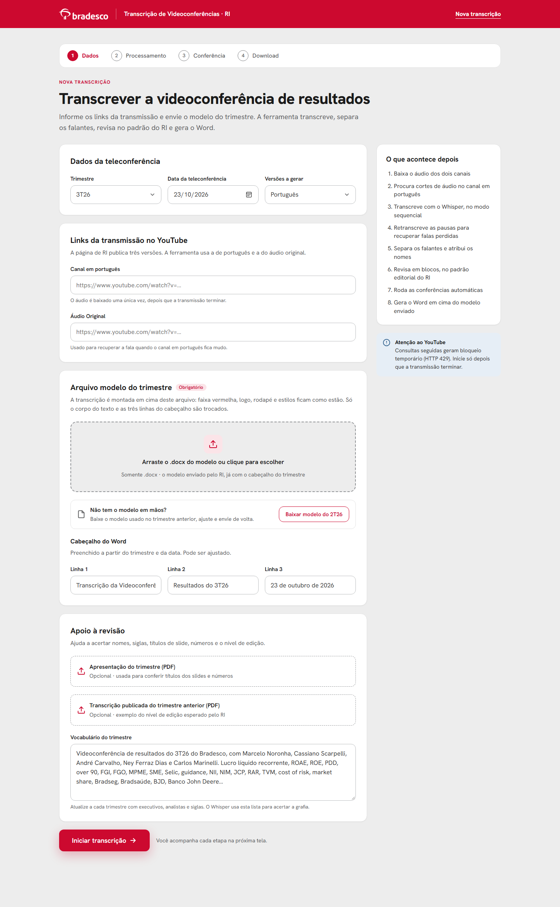
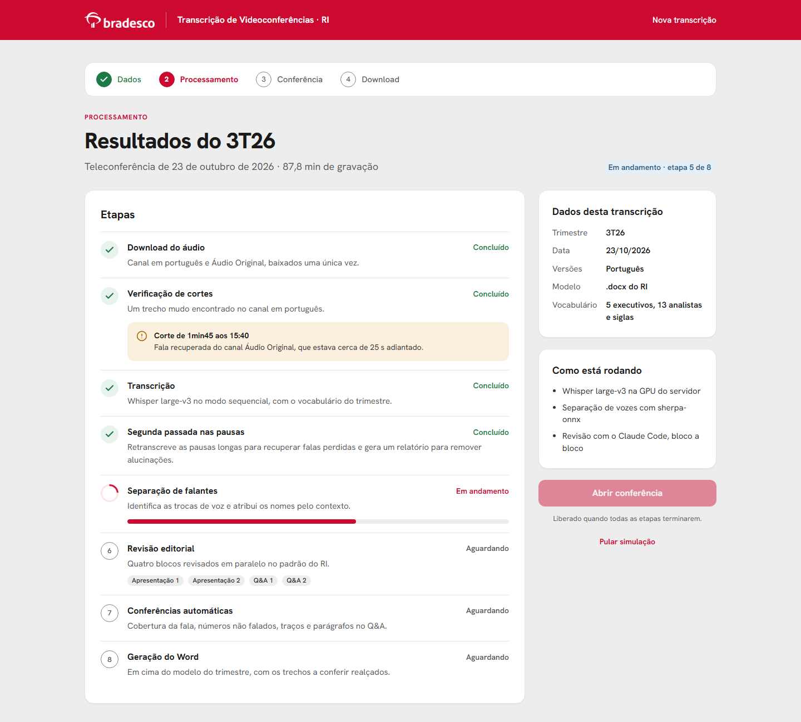
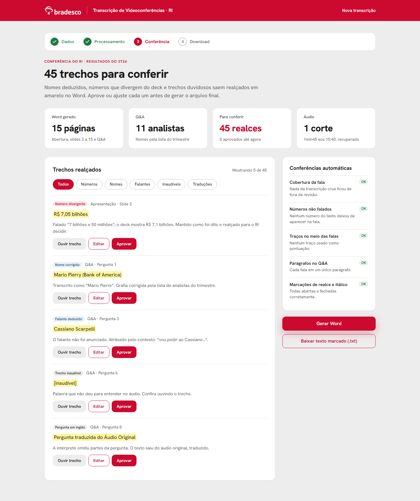
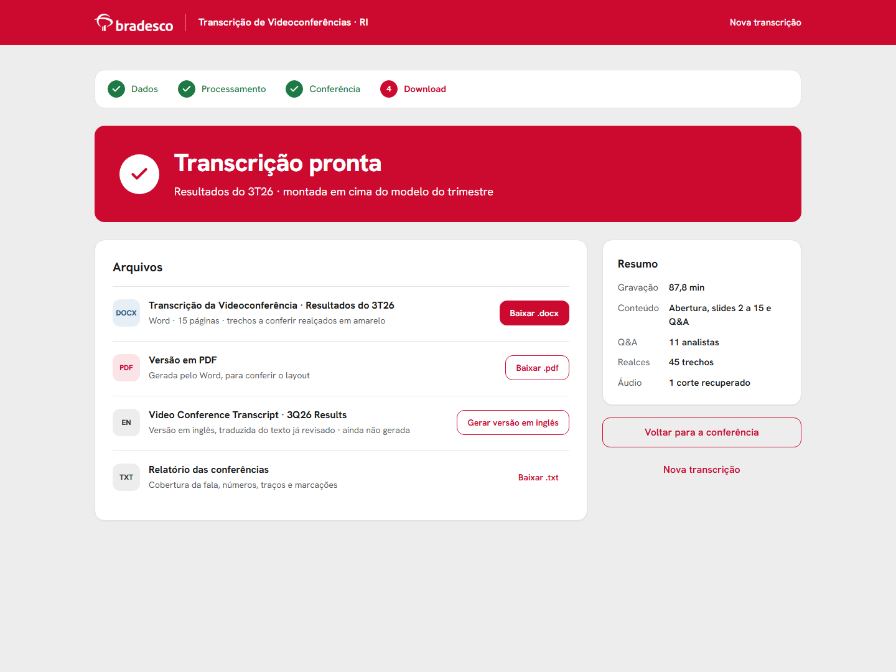

# Interface: proposta para o TI

Hoje o processo roda por linha de comando, script a script (veja o [README](../README.md)). Esta é a proposta de uma interface web para o RI usar sem abrir o terminal. A pessoa cola os links da transmissão, envia o modelo do trimestre, acompanha as etapas, confere os trechos realçados e baixa o Word.

A interface só organiza o que os scripts já fazem: cada campo e cada etapa abaixo apontam para o script e o parâmetro que usam hoje.

## Protótipo

- [`interface/prototipo.html`](../interface/prototipo.html): protótipo navegável, num arquivo só. Abra no navegador; não precisa de servidor.
  - Siga o fluxo pelos botões: Iniciar transcrição → Abrir conferência → Gerar Word.
  - O acompanhamento simula as etapas. Na conferência, os filtros e o botão Aprovar funcionam.
  - Os botões de download só mostram um aviso.
- Não processa áudio. Os 5 trechos da conferência, os "OK" das conferências automáticas e o andamento das etapas são exemplos. Os números do 3T26 são os reais: 87,8 min, 15 páginas, 11 analistas, 45 realces e o corte aos 15:40.
- Visual: cores, raios e sombras do Bradesco Design System. A fonte Hanken Grotesk está no lugar da Bradesco Sans, que é proprietária; troque quando o TI tiver os arquivos licenciados.

## Fluxo

| Tela | O que a pessoa faz | O que o sistema faz |
|---|---|---|
| 1. Nova transcrição | Preenche os dados, cola os links e envia o modelo `.docx` | Valida os campos e cria a transcrição |
| 2. Acompanhamento | Acompanha as etapas | Roda o processo, uma etapa depois da outra |
| 3. Conferência | Aprova ou edita os trechos realçados | Mostra os realces e o resultado das conferências automáticas |
| 4. Download | Baixa o Word, o PDF e, se quiser, gera a versão em inglês | Gera os arquivos em cima do modelo |

### 1. Nova transcrição

| Campo | Tipo | Obrigatório | Onde é usado hoje |
|---|---|---|---|
| Trimestre | lista (3T26, 4T26…) | sim | nome dos arquivos e linha 2 do cabeçalho |
| Data da teleconferência | data | sim | linha 3 do cabeçalho |
| Versões a gerar | lista: Português / Português e inglês | sim | último argumento do `build_docx.py` (`pt` ou `en`) |
| Canal em português | link do YouTube | sim | `yt-dlp --live-from-start -f 140` → `dados/pt.m4a` |
| Áudio Original | link do YouTube | sim | `yt-dlp` → `dados/original.m4a`, para recuperar cortes |
| Arquivo modelo do trimestre | `.docx` | sim | primeiro argumento do `build_docx.py`. A transcrição é montada em cima dele |
| Baixar modelo do trimestre anterior | botão | não | devolve o último modelo enviado, para a pessoa ajustar e reenviar |
| Cabeçalho do Word (linhas 1 a 3) | texto | sim | argumentos `linha1`, `linha2` e `linha3` do `build_docx.py` |
| Apresentação do trimestre | PDF | não | texto extraído (`pypdf`) e passado ao revisor, para títulos de slide e números |
| Transcrição publicada do trimestre anterior | PDF | não | texto extraído e passado ao revisor, como exemplo do nível de edição |
| Vocabulário do trimestre | texto livre | sim | prompt inicial do Whisper (`transcribe_seq.py` e `fill_gaps.py`) |

Regras:
- As linhas 2 e 3 do cabeçalho se preenchem sozinhas a partir do trimestre e da data ("Resultados do 3T26", "23 de outubro de 2026"). A pessoa pode editar.
- Na versão em inglês o cabeçalho muda para "Video Conference Transcript", "3Q26 Results" e "October 23^rd^, 2026". O `^...^` sai sobrescrito.
- O vocabulário vem preenchido com o do trimestre anterior (`docs/vocabulario_whisper_*.txt`).
- Aceitar só links do YouTube e só `.docx` no modelo.

### 2. Acompanhamento

| Etapa | Script | Entrada → saída | O que mostrar na tela |
|---|---|---|---|
| 1. Download do áudio | `yt-dlp` e `ffmpeg -ac 1 -ar 16000` | links → `dados/pt_16k.wav` e `dados/original_16k.wav` | concluído ou erro (por exemplo, bloqueio 429) |
| 2. Verificação de cortes | `verificar_cortes.py` | `pt_16k.wav` → lista de trechos mudos | alerta com horário e duração de cada corte |
| 3. Transcrição | `transcribe_seq.py` | `pt_16k.wav` + vocabulário → `saidas/seq.json` | progresso: o script imprime "hh:mm:ss de hh:mm:ss" |
| 4. Segunda passada nas pausas | `fill_gaps.py` | → `saidas/seq2.json` e `seq2_recuperado.txt` | o relatório, para a pessoa apagar alucinações como "Legenda Adriana Zanotto" |
| 5. Separação de falantes | `diarize.py` e `merge.py` | → `saidas/diar.json` e `saidas/turnos.txt` | progresso: o `diarize.py` imprime a porcentagem |
| 6. Revisão editorial | Claude Code, com `docs/instrucoes_revisor.md` e `docs/guia_estilo.md` | `blocos/X_entrada.txt` → `blocos/X_saida.txt`, para P1, P2, Q1 e Q2, em paralelo | andamento de cada bloco |
| 7. Conferências automáticas | `qa_cobertura.py` (por bloco), `verifica_ajustes.py` e `monta_final.py` | blocos → `saidas/final.txt` e relatórios | resultado de cada conferência |
| 8. Geração do Word | `build_docx.py` e `docx2pdf.ps1` | `final.txt` + modelo → `.docx` e `.pdf` | concluído |

Comportamento:
- Estados de cada etapa: Aguardando, Em andamento, Concluído e Erro, com opção de tentar de novo a partir da etapa que falhou.
- O botão "Abrir conferência" só fica ativo quando todas as etapas terminam.
- Baixar o áudio do YouTube uma vez só. Consultas seguidas geram bloqueio temporário (HTTP 429). Não tentar contornar com login.
- Uma transcrição por vez na GPU. As outras ficam na fila.

### 3. Conferência

- **Lista de realces:** cada trecho marcado com `==...==` no `saidas/final.txt`. Mostra onde está (slide ou pergunta do Q&A), o motivo e o trecho.
- **Motivos**, conforme o `docs/guia_estilo.md`: número divergente do deck, nome corrigido ou desconhecido, falante deduzido, trecho inaudível e pergunta em inglês traduzida do áudio original.
- **Ações por trecho:**
  - **Aprovar:** tira o realce, e o trecho sai sem amarelo no Word.
  - **Desfazer:** volta o realce.
  - **Editar:** altera o texto no `final.txt`.
  - **Ouvir trecho:** toca o áudio daquele ponto.
- O que não for aprovado continua realçado em amarelo no Word, para o RI conferir. É como funciona hoje.
- **Conferências automáticas:** cobertura da fala, números não falados, traços no meio das falas, parágrafos no Q&A e marcações abertas sem fechar. Cada uma com OK ou com a lista do que encontrou.
- **Gerar Word:** roda o `build_docx.py` de novo com o `final.txt` atualizado.

### 4. Download

- Word (`.docx`) montado no modelo do trimestre, com os realces que sobraram.
- PDF, para conferir o layout. Hoje é gerado pelo `docx2pdf.ps1`, que usa o Word instalado.
- **Gerar versão em inglês:** traduz o texto final já revisado, seguindo a seção em inglês do `guia_estilo.md`. Perguntas feitas em inglês saem do áudio original. Depois roda o `build_docx.py` com `en`.
- Relatório das conferências (`.txt`).

## Arquitetura sugerida

- **Front-end** web interno, com acesso restrito à equipe de RI.
- **Back-end** em Python, no mesmo ambiente dos scripts, rodando o processo como uma tarefa em segundo plano. Cada etapa chama o script atual. A interface não precisa reescrever a lógica.
- **Uma pasta por transcrição**, com a mesma estrutura de hoje: `dados/`, `saidas/` e `blocos/`. Facilita refazer uma etapa e auditar o resultado.
- **API**, como ponto de partida:

| Método e rota | Para quê |
|---|---|
| `POST /transcricoes` | cria a transcrição (formulário com os campos e os arquivos) |
| `GET /transcricoes/{id}` | estado de cada etapa, para a tela de acompanhamento |
| `GET /transcricoes/{id}/realces` | lista de trechos realçados |
| `PATCH /transcricoes/{id}/realces/{realce}` | aprovar, desfazer ou editar um trecho |
| `POST /transcricoes/{id}/word` | gerar o Word e o PDF de novo |
| `POST /transcricoes/{id}/ingles` | gerar a versão em inglês |
| `GET /transcricoes/{id}/arquivos/{nome}` | baixar `.docx`, `.pdf` ou relatórios |
| `GET /modelos/ultimo` | baixar o último modelo enviado |

## Requisitos de infraestrutura

- Servidor Windows com GPU NVIDIA. Foi testado numa RTX 2060 de 6 GB com `int8_float16`. Sem GPU funciona, mas fica bem mais lento.
- Python 3.12, `ffmpeg` e `yt-dlp`. Dependências em `requirements.txt`.
- Modelos baixados uma vez: Whisper large-v3 (~3 GB) e os modelos de separação de falantes do sherpa-onnx (links no README).
- Claude Code instalado e autenticado no servidor, para a revisão editorial.
- Microsoft Word, para converter o `.docx` em PDF.
- Acesso ao YouTube a partir do servidor.

## Pontos em aberto

1. **Recuperação de cortes.** Hoje é manual: quando o canal em português fica mudo, o mesmo trecho é transcrito do Áudio Original (passo 3 do README). Para automatizar, é preciso alinhar os dois canais, que têm alguns segundos de defasagem.
2. **Alucinações do Whisper.** O relatório do `fill_gaps.py` hoje é conferido à mão. A interface precisa mostrar esse relatório e deixar a pessoa apagar os trechos falsos.
3. **Divisão em blocos.** Os quatro blocos (P1, P2, Q1 e Q2) são separados à mão hoje. O sistema precisa achar o início do Q&A, quando o RI anuncia a sessão de perguntas, e dividir cada parte numa troca de falante.
4. **Revisão com IA.** Definir com o banco a conta, a licença e a política de dados para rodar o Claude Code no servidor.
5. **Ouvir trecho.** O `final.txt` não guarda o tempo de cada fala. É preciso ligar cada realce ao tempo no áudio, por exemplo casando o texto com as palavras do `seq2.json`.
6. **Regra de números.** O README diz para usar só os números falados. Já o `guia_estilo.md` e o `instrucoes_revisor.md` mandam corrigir pelo deck. Alinhar com o RI antes de implementar.
7. **Material interno.** Modelos `.docx`, áudios e transcrições não podem sair do ambiente do banco nem entrar no repositório.
